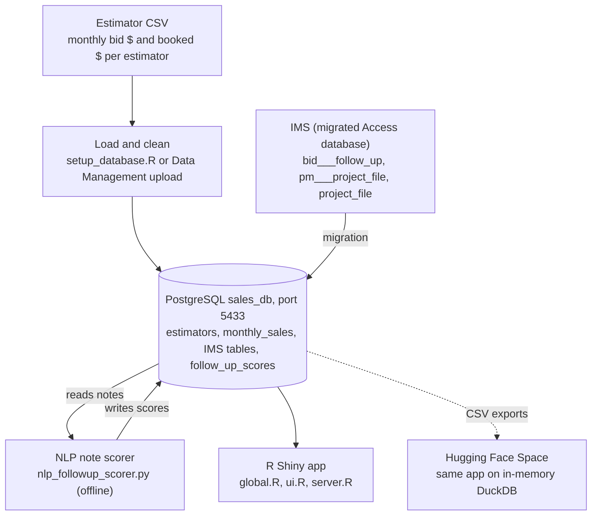

# Estimator Intelligence Dashboard

An R Shiny app that turns Perfect Margin's monthly bid and booking history into a performance view of each estimator. It answers four questions for leadership: who is winning work, what bookings to expect over the next 90 days, whether a process change actually moved results, and which contractors and project managers drive revenue.

**Plain English:** estimators bid on jobs every month; some of those bids turn into booked work. The dashboard tracks the gap between the two, per person and over time, and flags who is trending up, who is at risk, and when something changed.

**Technical:** R Shiny (`shinydashboard`) front end, PostgreSQL `sales_db` behind it through a `pool` connection, Plotly charts, two offline Python jobs (NLP note scoring and an experimental ML model), and a Docker setup.

| Fact | Value |
| --- | --- |
| Core dataset | `Bid_SalesAnalysisByEstimatorByMonth_121125.csv`, 424 rows, one per estimator per month |
| History covered | Apr 2010 to Dec 2025 |
| Estimators | 18 raw names, 17 after alias cleanup |
| Presented | Internally to Perfect Margin leadership; Red Rock Data Science Conference 2026 |
| Status | Feature-complete; hosted copy on a private Hugging Face Space |

*Last updated 10 Nov 2026.*

## Contents

- [Architecture](#architecture)
- [Data sources and schema](#data-sources-and-schema)
- [Dashboard tabs and analytics](#dashboard-tabs-and-analytics)
- [Setup and running locally](#setup-and-running-locally)
- [Deployment](#deployment)
- [Maintenance, limitations, and open items](#maintenance-limitations-and-open-items)

## Architecture

Two sources feed one PostgreSQL database; the Shiny app only reads from it, except for monthly uploads.



The hosted copy runs the same app against an in-memory DuckDB rebuilt from CSV exports on every start.

### Repo layout

| File | Role |
| --- | --- |
| `global.R` | Libraries, DB pool, `spc_limits()`, sources the cohort module |
| `ui.R` | Sidebar filters and the six tabs (`shinydashboard`) |
| `server.R` | All reactives, models, charts and exports (about 2,070 lines) |
| `mod_cohort_analysis.R`, `cohort_wiring_patch.R` | Cohort Win Rate module, not yet wired in |
| `setup_database.R`, `etl_process.R`, `force_load.R` | Build and load the database |
| `nlp_followup_scorer.py` | Scores follow-up notes into `follow_up_scores` |
| `load_ims_p_csvs.py` | Loads `ims_be_p.accdb` CSV exports as `p_*` tables |
| `ml_pipeline.py` | Experimental random-forest booking predictor |
| `report.Rmd` | PDF report template (xelatex) |
| `Dockerfile`, `docker-compose.yml` | Container setup (see Deployment) |
| `renv.lock` | Pinned R package versions |

## Data sources and schema

Everything starts from one monthly CSV export; optional IMS tables unlock the Client and Revenue tabs.

### Input CSV (from the estimating system)

| Column | Example | Meaning |
| --- | --- | --- |
| `EmployeeShort` | BN | Initials |
| `Estimator` | Bryan Narvaez | Full name (aliased on load) |
| `MoYear` | 25-03 | Month in `YY-MM`, parsed with `lubridate::ym()` to 2025-03-01 |
| `AmtBid` | 193,423.81 | Dollars bid that month (commas and `$` stripped) |
| `QtyBid` | 6 | Jobs bid |
| `AmtBooked` | 17,869.11 | Dollars booked that month |
| `QtyBooked` | 1 | Jobs booked |

### Core tables in `sales_db`

| Table | Key columns | Notes |
| --- | --- | --- |
| `estimators` | `id`, `primary_name` (unique), `active` | One row per clean name |
| `monthly_sales` | `estimator_id`, `report_date`, `amt_bid`, `qty_bid`, `amt_booked`, `qty_booked` | `UNIQUE(estimator_id, report_date)` blocks double loads |

### Optional IMS tables (migrated Access data)

| Table | Feeds | Created by |
| --- | --- | --- |
| `bid___follow_up` | Client Intelligence (follow-up notes, contractor, date, estimator) | The Access to PostgreSQL migration |
| `follow_up_scores` | Award-signal feed and NLP chart | `nlp_followup_scorer.py` |
| `pm___project_file` + `project_file` | Revenue Intelligence (PM, contract value, GC, completion) | The migration |
| `p_*` | Not used by the app yet | `load_ims_p_csvs.py` |

Each tab checks `dbExistsTable()` first, so a missing IMS table leaves that tab empty instead of crashing the app.

### Name cleanup

Three spellings, `Scott W. Hutchings`, `SW` and `SH`, collapse to **Scott Hutchings**. The rule is a hard-coded `case_when()` repeated in six places: `server.R` (upload), `etl_process.R`, `force_load.R`, `setup_database.R`, and the two IMS SQL queries. Any new alias must be added in all of them; a database-editable alias table is an open item.

## Dashboard tabs and analytics

Six tabs share one sidebar of filters; the first four run on `monthly_sales`, the last two on IMS tables.

### Sidebar filters (apply to tabs 1 and 2)

| Control | Default | Effect |
| --- | --- | --- |
| View Range | Last 24 months of data | Date window for KPIs, charts, scorecard, forecast |
| SPC Baseline Period | Months 60 to 25 before the latest month | Window used to compute control limits |
| Breakdown Mode | Aggregate | Aggregate, or one line per estimator |
| Time Scale | Monthly | Monthly or quarterly roll-up |
| Win Rate Lag | 3 months | Credits bookings that land 1 to N months after the bid month; 0 = same month |
| Estimators | All | Multi-select filter |

### 1. Top Brief (CEO view)

A one-screen summary with a downloadable Excel brief.

- **Scorecard:** each estimator gets a 0 to 100 composite score from four min-max-scaled parts: Win Quality 35%, Efficiency 20%, Stability 20%, Output 25% (weights adjustable on screen). Stability is 1 minus the scaled coefficient of variation of monthly bookings.
- **Risk flag:** *At Risk* when win rate < 12% or booking CV > 1.25; *Watch* within 6 points or 80% of those cut-offs; otherwise *Healthy*. Both cut-offs are adjustable.
- **90-day forecast:** for each estimator with at least 10 months of history, a log-linear regression `log1p(booked) ~ log1p(bid) + log1p(last month's booked) + month + trend`, rolled forward three months using the average of the last three months' bids. The band is ±1.28 residual SD (an 80% range), reported with the model's in-sample MAE.

### 2. Executive Dashboard

- **KPIs:** total bid, total booked, same-month win rate (booked $ ÷ bid $), lagged win rate.
- **Pipeline correlation:** Pearson r between jobs bid and dollars booked, translated into a plain-English verdict (negative = estimator fatigue, < 0.3 = quality over quantity, otherwise healthy).
- **SPC control charts** (dollars and quantity): mean ± 3 SD from the baseline period; points outside the limits are marked *Anomaly*. Lower limit floored at 0. Logic lives in `spc_limits()` in `global.R`.
- **Annual, YoY growth, Quarterly Deep Dive:** bar charts by year and quarter.
- **Bid Funnel:** bid vs booked dollars per estimator, with win-rate labels.
- **Seasonality Heatmap:** year × month grid of booked or bid dollars (ignores the date filter so the full history shows).
- **K-means segmentation:** clusters estimators on scaled total bid, win rate and average job size (k = 3, 25 starts, seed 42). Clusters are named by mean win rate: High-Efficiency, Selective, New/Developing.
- **Leaderboard:** sortable table of the same metrics.

### 3. Intervention Analysis (ITS)

Tests whether a dated event (a new hire, a process change) changed an estimator's trend. Pick an estimator with at least 18 months of data, a metric, and either a manual date or auto-detection.

- **Auto-detect:** `strucchange::breakpoints()` (minimum segment 6 months) proposes break dates, ranked by F-statistic; click one to use it.
- **Model:** segmented regression `value ~ t + D + t_post`, where `D` is the level change and `t_post` the slope change after the date. Coefficients are tested with `lmtest::coeftest()`, significant at p < 0.05.

### 4. Data Management

Upload a new monthly CSV (same layout as the input file). The app cleans names, inserts new estimators, and merges rows with `ON CONFLICT DO NOTHING`, so re-uploading overlapping months is safe, but corrected figures for an existing month are **not** overwritten. Also shows a raw-vs-parsed date check and an Excel report export.

### 5. Client Intelligence

Reads `bid___follow_up` notes: top contractors by follow-up activity, a timeline, an estimator × contractor matrix, and an award-signal feed. The award signal comes from `nlp_followup_scorer.py`, run offline:

1. Keyword dictionaries (strong award, moderate, negative, neutral) auto-label each note.
2. TF-IDF (1 to 3 grams, 300 features) plus 11 hand-built features train a balanced logistic regression; CV F1 is printed.
3. Every note gets an award probability, binned into Neutral / Pending, Mild Positive, Likely Award and Strong Award Signal, and is written to `follow_up_scores`.

The labels come from the same keywords used as features, so the model mostly learns the rules back. Treat the scores as a ranked triage list, not a calibrated probability.

### 6. Revenue Intelligence

Joins `pm___project_file` to `project_file` for executed contracts (contract amount > 0): contract value by project manager, project completion pipeline, GC revenue concentration, and a project detail table, filterable by PM, contractor and date created.

## Setup and running locally

The working local path is PostgreSQL on port 5433, `setup_database.R` to build and load, then `shiny::runApp()`.

### Prerequisites

- PostgreSQL running locally on **port 5433**, peer auth as your OS user (no password)
- R with `renv` (the repo has `renv.lock`); key packages: `shiny`, `shinydashboard`, `shinyWidgets`, `tidyverse`, `lubridate`, `plotly`, `DT`, `DBI`, `RPostgres`, `pool`, `cluster`, `strucchange`, `lmtest`, `openxlsx`
- Python 3 with `pandas`, `sqlalchemy`, `psycopg2-binary` and `scikit-learn` (only for the NLP and IMS loader scripts)

### Steps

1. Restore packages: open the `.Rproj`, then run `renv::restore()`.
2. Build and load the database (creates `sales_db`, both tables, and loads the CSV):

   ```bash
   Rscript setup_database.R
   ```

3. Optional: score follow-up notes for Client Intelligence (needs `bid___follow_up` already migrated):

   ```bash
   python nlp_followup_scorer.py
   ```

4. Start the app from the repo folder:

   ```bash
   R -e "shiny::runApp('.', port = 3838, launch.browser = TRUE)"
   ```

### Connection settings

`global.R` reads environment variables, falling back to local defaults:

| Variable | Default |
| --- | --- |
| `DB_NAME` | `sales_db` |
| `DB_HOST` | `localhost` |
| `DB_PORT` | `5433` |
| `DB_USER` | your OS username |
| `DB_PASS` | (blank) |

The Python scripts, `etl_process.R` and `force_load.R` hard-code port 5433 and do **not** read these variables.

### Which loader script to use

| Script | Use it when |
| --- | --- |
| `setup_database.R` | First-time setup: creates the DB and tables, loads the CSV |
| `etl_process.R` | Reloading the CSV into an existing DB |
| `force_load.R` | A load fails and you need diagnostics (checks file path and connection, prints row count) |
| Data Management tab | Routine monthly updates (preferred) |
| `sales_db.R`, `setup_database.sql`, `database.sql` | Older drafts, superseded by `setup_database.R` |

## Deployment

The live, shareable copy runs on a private Hugging Face Docker Space; the Docker files in this repo are an older, unfinished path.

### Hugging Face Space (current)

- Drops PostgreSQL. At startup it seeds an **in-memory DuckDB** from CSV exports: the bid sales CSV plus the IMS follow-up, follow-up scores and project tables.
- Its code lives in the Space's own repo, not here; the DuckDB version of `global.R` is not yet in this repo.
- **To refresh data:** export updated CSVs (run `nlp_followup_scorer.py` first and export `follow_up_scores` if notes changed), replace them in the Space repo, and push. The Space rebuilds and reseeds on start. Nothing persists between restarts, so uploads made in the hosted Data Management tab are lost on rebuild.

### Hosted copy: known issues (10 Nov 2026)

| Issue | Detail | Status |
| --- | --- | --- |
| Revenue Intelligence shows $0M, 0 projects | The query returns zero rows before any filter runs. The IMS tables are seeded by `seed_data.R`. | Under investigation |
| DuckDB opened with no path | `dbdir = ":memory:"` was passed to `dbPool()` instead of `duckdb()`, so DuckDB fell back to `~/.duckdb` and prompted to create it. Fix: `dbPool(drv = duckdb::duckdb(dbdir = ":memory:"))` | Fixed locally, not yet deployed |
| Seeding written twice | `build_duckdb_from_csv()` is defined but never called; a `local({...})` block below it does the same work | Keep one |
| Failures look like empty filters | IMS tabs return an empty table when a table is missing or a join matches nothing, so the screen says "No project data for selected filters" | Planned: startup data checks that name the failing table |

### Docker Compose (needs fixes before use)

`docker-compose.yml` defines a Postgres container (port 5432) and the Shiny app on port 3838, passing `DB_*` variables. As committed it will not run:

- `Dockerfile` launches `/srv/shiny-server/app.R`, which does not exist (the app is split into `global.R`, `ui.R` and `server.R`). Run the folder instead: `shiny::runApp('/srv/shiny-server', ...)`.
- It copies only the three app files, so `mod_cohort_analysis.R` (sourced by `global.R`) is missing.
- It installs 9 packages; `global.R` also needs `pool`, `cluster`, `openxlsx`, `strucchange` and `lmtest`.
- The Postgres container starts empty: run the loader against port 5432 before the app has data.
- The DB password is in plain text in the compose file; move it to an `.env` file before anything beyond local use.

## Maintenance, limitations, and open items

### Monthly update routine

1. Export the new month's *Bid Sales Analysis by Estimator by Month* CSV.
2. Upload it in **Data Management** (local). New months append; existing months are skipped.
3. If an existing month's numbers were corrected, delete those `monthly_sales` rows first; the upload will not overwrite them.
4. If a new name variant appears, add it to every alias `case_when()` (see Name cleanup).
5. For the hosted copy, refresh the Space's CSVs (see Deployment).

### Known defects

| Priority | Issue | Where | Fix |
| --- | --- | --- | --- |
| High | `.gitignore` line `.Renviron*.xlsx` is two rules fused, so neither `.Renviron` nor `*.xlsx` is ignored | `.gitignore` | Split onto two lines |
| Medium | Docker build cannot start the app | `Dockerfile` | See Docker Compose fixes |
| Medium | Third k-means cluster is named *New/Developing* but the colour scale defines *High-Volume*, so it plots without its colour | `server.R`, `scatter_matrix` | Rename one to match |
| Low | Stray `x` after `CREATE TABLE monthly_sales (` makes the file fail | `database.sql` | Delete the file (superseded) or fix |
| Low | Cohort Win Rate module is sourced but never added to the UI or server | `mod_cohort_analysis.R`, `cohort_wiring_patch.R` | Apply the two patches, or remove the module |
| Low | `ml_pipeline.py` uses a random train/test split on time-series data and a hard-coded scenario | `ml_pipeline.py` | Treat as a demo; use a temporal split if revived |
| Low | Empty files | `scratch.R`, `tutorial.R` | Delete |

### Limitations to state when presenting

- Win rate is dollars booked ÷ dollars bid in the window, not a per-bid match. Bids and bookings are monthly totals, so a booking cannot be traced to the bid that produced it; the lag setting is an approximation.
- The forecast is fit and scored in-sample, so its MAE is optimistic.
- NLP award scores are keyword-driven triage (see Client Intelligence).
- Estimators with little history make k-means and composite scores unstable; both rescale relative to whoever is in the filter.

### Open items

- [ ] Database-editable alias table to replace the hard-coded name mapping
- [ ] Pending vs lost bid classification flag
- [ ] Find why Revenue Intelligence is empty on the Space, and deploy the DuckDB fix
- [ ] Startup data checks so load failures name the failing table
- [ ] Decide: wire in or delete the Cohort Win Rate module
- [ ] Commit the Hugging Face DuckDB version to this repo so one repo holds the deployable code
